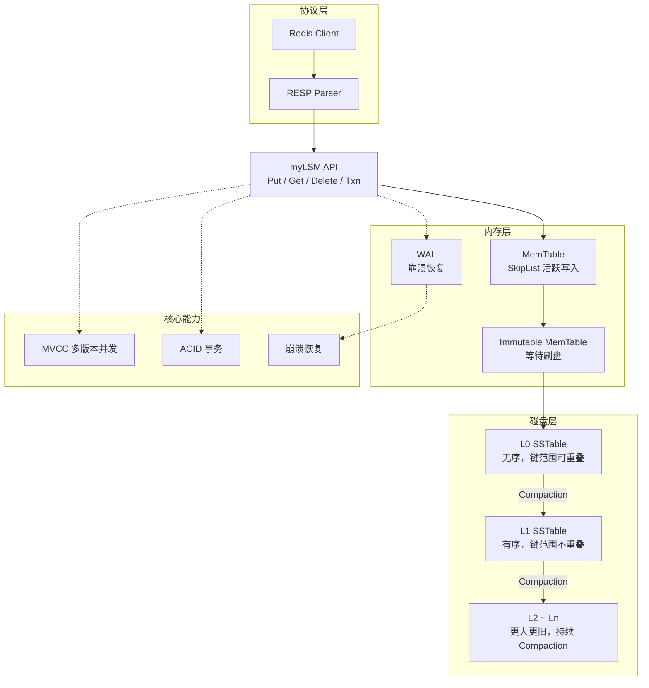

# myLSM
> 一个基于 LSM Tree 的轻量级持久化 KV 存储引擎，兼容 Redis 协议，支持 ACID 事务与 MVCC。

## 项目介绍
本项目主要实现了以下内容：
- 对Redis RESP协议的兼容，
- 基于RESP协议的redis server封装
- ACID事务
- MVCC（多版本并发控制）
- WAL（Write-Ahead-Log）
- 崩溃恢复
- 该项目用于深化对数据库相关知识如ACID，MVCC等的理解，学习Redis

### 环境要求
- WSL2 Ubuntu 20.04+
- C++17 (建议明确到 17，C++11 对于现代项目偏低)
- xmake >= 2.8.x
- vcpkg

### 构建
TODO

### 运行测试
TODO

### 功能状态表
TODO

## 架构图

## 项目文件结构
TODO